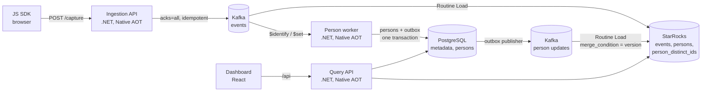

# ReapDeep

[](https://github.com/guvenimat/ReapDeep/actions/workflows/ci.yml)
[](LICENSE)

Multi-tenant, high-performance web product analytics, in the spirit of PostHog and Mixpanel.
A tiny JavaScript SDK captures events, a Native AOT .NET ingestion API writes them to Kafka,
StarRocks makes them queryable within seconds, and a React dashboard answers trend, funnel,
retention, path and person questions over hundreds of millions of events.


- **Analyses:** trends (totals, unique users, breakdowns), funnels with conversion windows, weekly or daily retention cohorts, user paths, a live event stream and person profiles; any of them can be saved and arranged on dashboards.
- **Fast ingestion:** 50K events/s on a single machine with p99 under 10 ms; a `202` response means the event is durably in Kafka.
- **Fresh data:** events are queryable in 4-11 s (Kafka -> StarRocks Routine Load).
- **Identity resolution:** anonymous visitors are merged into identified users; their earlier events count as the same person in trends and funnels.
- **Multi-tenant by design:** shared tables keyed by `project_id`; every StarRocks query comes from a single SQL builder that always adds the project and time filters.
- **Small footprint:** ~2.4 KB gzip SDK with no dependencies, 30-50 MB ingestion process, dashboard without chart or UI libraries.
- **Permissive licensing only:** Apache 2.0 for this repo; every dependency is MIT or Apache 2.0.

## Architecture



| Component | Path | Stack |
|---|---|---|
| Ingestion API | `src/ReapDeep.Ingestion` | .NET 10 Minimal API, Native AOT, Confluent.Kafka |
| Person worker | `src/ReapDeep.PersonWorker` | .NET 10 Worker, Native AOT, transactional outbox |
| Query API | `src/ReapDeep.QueryApi` | .NET 10 Minimal API, Native AOT, MySqlConnector, Npgsql |
| JS SDK | `sdk/js` | TypeScript, esbuild (ESM + IIFE) |
| Dashboard | `dashboard` | React 19, TypeScript, Vite, hand-written SVG charts |
| Load test | `tests/ReapDeep.LoadTest` | .NET 10 console app |
| Local stack | `deploy/local` | Docker Compose: Kafka 4.1 (KRaft), StarRocks 4.0, PostgreSQL 17 |

### How it works

- **Ingestion.** The API validates the project key, parses the user agent, corrects client clock skew using `sent_at`, and promotes common properties (URL, UTM, browser, OS, device) to columns. It returns `202` only after Kafka acknowledges every event in the batch, and `503` otherwise. The SDK retries with the same `event_id`.
- **Storage.** `events` is a Duplicate Key table partitioned by day. `persons` and `person_distinct_ids` are Primary Key tables. `events` and `person_distinct_ids` share a colocate group distributed by `HASH(project_id, distinct_id)`, so the person join runs locally on each node.
- **Identity.** PostgreSQL is the source of truth for persons. The worker applies merge rules (two identified persons are never merged) and writes changes to an outbox in the same transaction. A publisher forwards them to Kafka, and StarRocks applies them in version order.
- **Definitions.** The ingestion API keeps an in-memory set of the event names, event properties and `$set` person properties it has seen per project, with an inferred type (string, number, boolean, datetime). New names are written to PostgreSQL (`event_definitions`, `property_definitions`) in batches every 10 s, and known names are refreshed at most once an hour, so the hot path never waits on the database. The dashboard's autocomplete reads them from `GET /api/v1/metadata`. Each project is capped at 10K names per scope.
- **Deletion.** Owners and admins request deletion of a person or a `distinct_id` (`POST /api/v1/deletion-requests`). A periodic batch job in the person worker (daily by default) deletes the events from StarRocks with one `DELETE` per project, removes the identity rows from PostgreSQL, and sends tombstones through the outbox so StarRocks drops the mappings and person properties in version order; the tombstones are purged later. Batching keeps StarRocks delete-predicate and compaction load low.
- **Queries.** A person is `COALESCE(pdi.person_id, e.distinct_id)` over a `LEFT JOIN`, so anonymous events are never dropped. Date filters use UTC boundaries for partition pruning; the project time zone is used only for bucketing.

## Quick start

Requirements: Docker with at least **8 GB of RAM**. The .NET 10 SDK and Node.js 22+ are only needed for development outside Docker.

**Windows (PowerShell):**

```powershell
cd deploy/local
.\run-local.ps1                               # creates .env, starts the data stack, runs a smoke test
docker compose --profile app up -d --build    # ingestion, person worker, query API, dashboard
```

**Linux / macOS:**

```bash
cd deploy/local
./smoke-test.sh                               # creates .env if missing (run after the stack is up)
docker compose --profile app up -d --build
```

On first start, `.env` is created with random local credentials: the PostgreSQL password, a project read API key (`READ_API_KEY`), the dashboard admin account (`ADMIN_EMAIL`, `ADMIN_PASSWORD`) and the password of the read-only StarRocks user the Query API connects with. Missing keys are added to an existing `.env` automatically. The file is git-ignored, and every port is bound to `127.0.0.1`.

| Service | Address |
|---|---|
| Dashboard | http://localhost:3000 (sign in with `ADMIN_EMAIL` / `ADMIN_PASSWORD` from `.env`) |
| Ingestion API | `POST http://localhost:8000/capture` (local project key `pk_dev_local`) |
| Query API | http://localhost:8001 (`Authorization: Bearer <READ_API_KEY>`, or a dashboard session) |
| StarRocks (MySQL protocol) | `localhost:9030`, user `root` |
| PostgreSQL | `localhost:5432`, user `reapdeep`, password in `.env` |
| Kafka | `localhost:9092` |

### Send an event

```bash
curl -i http://localhost:8000/capture -d '{
  "api_key": "pk_dev_local",
  "batch": [{ "event": "$pageview", "distinct_id": "user_1",
              "properties": { "$current_url": "https://example.com/pricing" } }]
}'
```

### Query it

```bash
READ_API_KEY=$(grep READ_API_KEY .env | cut -d= -f2)
curl http://localhost:8001/api/v1/query/trends \
  -H "Authorization: Bearer $READ_API_KEY" -H "Content-Type: application/json" \
  -d '{ "series": [{ "event": "$pageview", "metric": "unique_users" }], "interval": "day" }'
```

Other endpoints: `POST /api/v1/query/funnels`, `POST /api/v1/query/retention`, `POST /api/v1/query/paths`, `GET /api/v1/events`, `GET /api/v1/persons[/{id}]`, `GET /api/v1/metadata`, `GET /healthz`.

### Demo data

```powershell
cd deploy/local
.\demo-data.ps1     # ~22K events from 3,000 visitors over 8 weeks, sent through the ingestion API
```

The seed creates a **Demo Shop** project with a deterministic store scenario: traffic sources, desktop and mobile browsers, product pages, a cart and checkout funnel, sign-ups that merge anonymous history, and returning visitors over the following weeks. It also creates a "Demo Shop overview" dashboard. Pick the project in the top bar and choose "Last 30 days".

| Funnel with breakdown | Weekly retention |
|---|---|
|  |  |

| Paths | Person profile |
|---|---|
|  |  |

Dark mode uses its own validated color steps: [screenshot](docs/images/dashboard-dark.png).

### Retention and paths

- **Retention:** cohorts are formed from the first time a person did the start event in the selected range, daily or weekly. Each cell is the share of the cohort that did the return event in that period; periods that have not happened yet are empty, and the average row is weighted by cohort size.
- **Paths:** each person's first start event in the range, followed by their next events within a window (30 min to 1 day), with repeats in a row collapsed and `$pageview` split by page. The result has the top events per step and the most common full paths.

### Saved insights and dashboards

Any trend or funnel can be saved by name from its tab (`/api/v1/insights`). A dashboard (`/api/v1/dashboards`) is an ordered list of saved insights rendered as tiles; the date range picker applies to every tile, and a tile's title opens the insight for editing. Insights store the editor state, not the date range, so the same insight works for "last 24 hours" and "last 30 days". Project members can create and edit them; read API keys can only list them.

### Authentication

- **API keys** (`Authorization: Bearer <key>`) are scoped to one project and are read-only; they cannot create deletion requests. Use them for scripts and integrations.
- **Dashboard sessions:** `POST /api/v1/auth/login` sets an HttpOnly, `SameSite=Strict` cookie valid for 14 days. Requests then name the project in the `X-Project-Id` header, and the API checks the user's organization membership. `GET /api/v1/auth/me` returns the user and their projects; `POST /api/v1/auth/logout` revokes the session.
- Passwords are hashed with PBKDF2-SHA256 (600K iterations), and sign-in is rate limited to 10 attempts per minute per client IP.
- On first start, the Query API creates the `ADMIN_EMAIL` user as owner of every organization when the `users` table is empty.
- **Settings** (dashboard tab and `/api/v1/members`, `/api/v1/api-keys`, `/api/v1/auth/password`): owners and admins add members with a temporary password, change roles and remove members; anyone can change their own password, which signs out their other sessions. Admins cannot create or change owners, and the last owner cannot be demoted or leave. API keys are shown once at creation and stored only as a SHA-256 hash; revoking one takes effect immediately.

### Add the SDK to a page

```html
<script src="reapdeep.min.js"></script>
<script>
  const rd = reapdeep.init('pk_dev_local', { apiHost: 'http://localhost:8000' })
  rd.capture('signed_up', { plan: 'pro' })
  rd.identify('user_123', { email: 'a@example.com' })
</script>
```

Page views (including SPA navigation), sessions, UTM parameters, batching, retries and `sendBeacon` on page unload are handled automatically. See [`sdk/js/README.md`](sdk/js/README.md).

## Performance

Measured with `deploy/local/load-test.ps1` on **a single machine** (16 CPU, 15 GB shared by Docker): the load generator, ingestion, Kafka, a single-node StarRocks and PostgreSQL all run on the same host. The numbers show where the bottlenecks are, not production capacity.

### Ingestion

| Scenario | Achieved | p50 | p95 | p99 | Lost events | Freshness | Ingestion API |
|---|---|---|---|---|---|---|---|
| 10K/s, batch 10, 30 s | 9,999/s | 4.0 ms | 6.5 ms | **7.0 ms** | 0 / 300K | - | 51% CPU, 30 MB |
| 10K/s sustained, batch 50, 60 s | 10,000/s | 6.1 ms | 7.2 ms | **7.4 ms** | 0 / 600K | **3.9 s** | 28% CPU, 31 MB |
| 50K/s peak, batch 100, 20 s | 49,975/s | 5.6 ms | 7.8 ms | **9.2 ms** | 0 / 1M | **10.6 s** | 113% CPU, 49 MB |

Targets: p99 < 50 ms, freshness < 30 s, no loss after `202`. All met with zero Routine Load error rows.

### Queries over 100M events

The seed is 100M events over 30 days, 150K identified persons and 300K distinct IDs. It takes 2.59 GB on disk (ZSTD, 27.3 bytes per event). Each query ran once cold and then 20 times warm.

| Query | p95 | Target |
|---|---|---|
| Trend, total count, daily | **110 ms** | < 1 s, met |
| Trend, unique users (person join) | **1,135 ms** | < 1 s, borderline |
| Trend, unique users + breakdown + filter | **1,115 ms** | < 1 s, borderline |
| Trend with person property filter | **779 ms** | < 1 s, met |
| Trend with exact deduplication | 1,404 ms | optional |
| Funnel, 3 steps, exact | 4,128 ms | < 3 s, **not met** on one node |
| Funnel, 3 steps, 10% sampling | **790 ms** | met (error ~0.3%) |
| Funnel + breakdown, 25% sampling | **1,243 ms** | met (error ~0.5%) |
| Events of one person (bucket pruning) | **28 ms** | - |

The optimizations that got us here: a fixed-offset time bucketing path when the range has no DST change, separate parallel queries instead of `GROUPING SETS`, aggregating to `(distinct_id, bucket)` before the person join, 64-bit hashes for deduplication and funnel keys, and optional deterministic person sampling for funnels. Exact results stay the default. The unique-user and exact-funnel numbers still need to be measured on a multi-node StarRocks cluster.

## Tests

```powershell
cd deploy/local
.\identity-test.ps1     # identity resolution, 10 end-to-end scenarios
.\auth-test.ps1         # sign-in, sessions, project access, CORS, X-Forwarded-For, StarRocks grants
.\deletion-test.ps1     # deletion requests and the batch job, end to end
.\settings-test.ps1     # members, roles, password change, API keys
.\insights-test.ps1     # saved insights and dashboards, API and browser
.\query-test.ps1        # Query API: trends, funnels, events, persons, EXPLAIN, latency
.\dashboard-test.ps1    # headless Chrome against the dashboard (Chrome DevTools Protocol)
.\load-test.ps1         # ingestion load, 100M seed, query benchmark, cleanup

cd ../../sdk/js
npm test                # SDK unit tests (vitest + jsdom)
.\demo\e2e.ps1          # real browser -> ingestion -> Kafka -> StarRocks
```

Useful commands:

```bash
docker compose exec starrocks mysql -h127.0.0.1 -P9030 -uroot
docker compose exec starrocks mysql -h127.0.0.1 -P9030 -uroot -e "SHOW ROUTINE LOAD FROM analytics\G"
docker compose --profile app down -v    # reset everything, including data
```

Init SQL runs only on empty volumes. After a schema change, run `docker compose down -v` and start again. To run a .NET service outside Docker, pass connection strings through the environment, for example `ConnectionStrings__Postgres="Host=localhost;Database=reapdeep;Username=reapdeep;Password=<from .env>"`.

## Repository layout

```
src/ReapDeep.Ingestion      Ingestion API
src/ReapDeep.PersonWorker   identity resolution worker
src/ReapDeep.QueryApi       Query API and the single SQL builder (SqlBuilder.cs)
sdk/js                      browser SDK
dashboard                   React dashboard, served by nginx
tests/ReapDeep.LoadTest     load generator, seeder and query benchmark
deploy/local                Docker Compose stack, schemas and test scripts
```

## Status and limitations

ReapDeep is an early v1. It runs end to end locally but has not been operated in production yet.

- Members are added with a temporary password; there are no invitation emails or password reset by email.
- A person's `created_at` is the time the person worker processed their first `$identify` or `$set`, not the event's own timestamp; it only differs for backfilled data such as the demo seed.
- Retention and paths read raw events and join persons on every query; they are fast on the demo and test data but were not part of the 100M-event benchmark.
- Not in v1: session replay, mobile SDKs, autocapture, feature flags.
- Behind a load balancer, set `ForwardedHeaders__TrustedNetworks` (CIDR list) on the ingestion and Query APIs; `X-Forwarded-For` is ignored otherwise. The Query API sends no CORS headers unless `QueryApi__CorsOrigins` is set.
- The deletion job runs every 30 s in the local compose file so tests finish quickly; the default is once a day (`Deletion__IntervalSeconds`). Raw events also stay in Kafka for its 7-day retention.

## License

Licensed under the [Apache License, Version 2.0](LICENSE). See [NOTICE](NOTICE) for attribution.
