# ReapDeep

[](https://github.com/guvenimat/ReapDeep/actions/workflows/ci.yml)
[](LICENSE)

Multi-tenant, high-performance web product analytics, in the spirit of PostHog and Mixpanel.
A tiny JavaScript SDK captures events, a Native AOT .NET ingestion API writes them to Kafka,
StarRocks makes them queryable within seconds, and a React dashboard answers trend, funnel,
retention, path and person questions over hundreds of millions of events.

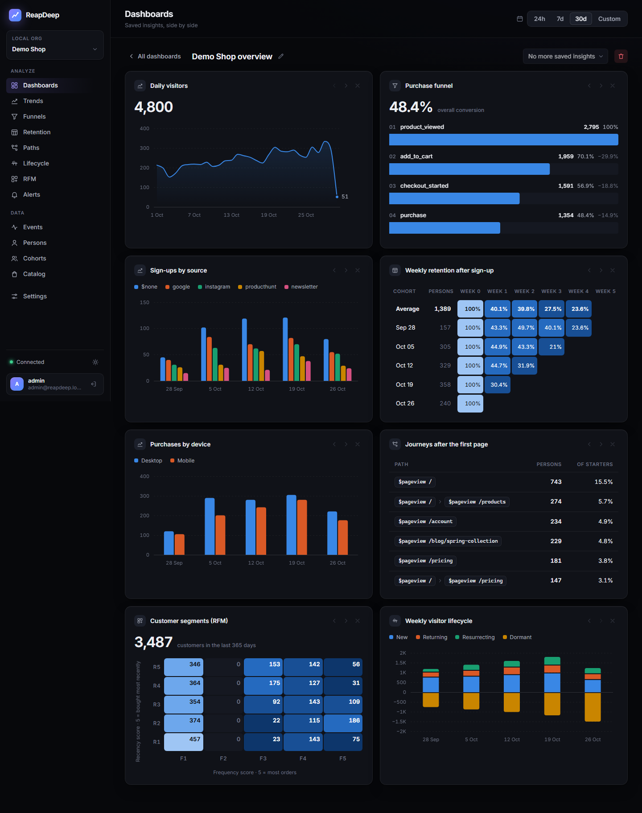

- **Analyses:** trends (totals, unique users, sum/average/median/p90 of a property, formulas such as `A / B`, comparison with the previous period, breakdowns), funnels with conversion windows, time to convert and the list of persons who dropped off at each step (savable as a cohort), weekly or daily retention cohorts, user paths, lifecycle (new, returning, resurrecting, dormant), RFM customer segments, a live event stream and person profiles; any of them can be saved and arranged on dashboards.
- **Recommendations:** a product catalog plus popular, trending, viewed-together and bought-together suggestions, served to your site by a public endpoint from memory and measured with a hit-rate check.
- **Alerts:** a saved trend can call a webhook when it goes above or below a threshold, or grows or drops by a percentage against the previous window; payloads are signed with HMAC-SHA256.
- **Cohorts:** segments defined by behavior ("viewed a product 3+ times in 30 days but did not buy") or person properties, or uploaded as a list; every analysis can filter or break down by them.
- **Fast ingestion:** 50K events/s on a single machine with p99 under 10 ms; a `202` response means the event is durably in Kafka.
- **Fresh data:** events are queryable in 4-11 s (Kafka -> StarRocks Routine Load).
- **Identity resolution:** anonymous visitors are merged into identified users; their earlier events count as the same person in trends and funnels.
- **Multi-tenant by design:** shared tables keyed by `project_id`; every StarRocks query comes from a single SQL builder that always adds the project and time filters.
- **Small footprint:** ~2.6 KB gzip SDK with no dependencies, 30-50 MB ingestion process, dashboard without chart or UI libraries.
- **Permissive licensing only:** Apache 2.0 for this repo; every code dependency is MIT or Apache 2.0, and the self-hosted Inter font is under the SIL Open Font License 1.1.

## Architecture

The design decisions, alternatives and measurements behind each component are written up in
[docs/architecture.md](docs/architecture.md).

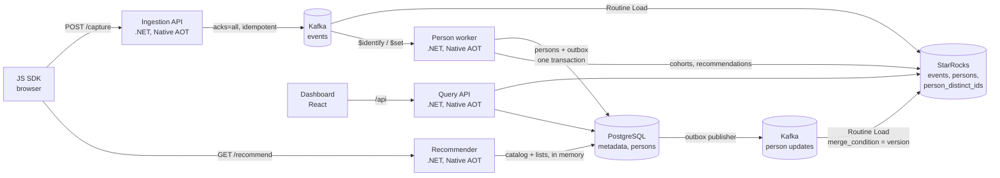

| Component | Path | Stack |
|---|---|---|
| Ingestion API | `src/ReapDeep.Ingestion` | .NET 10 Minimal API, Native AOT, Confluent.Kafka |
| Person worker | `src/ReapDeep.PersonWorker` | .NET 10 Worker, Native AOT, transactional outbox |
| Query API | `src/ReapDeep.QueryApi` | .NET 10 Minimal API, Native AOT, MySqlConnector, Npgsql + Dapper.AOT |
| Recommender | `src/ReapDeep.Recommender` | .NET 10 Minimal API, Native AOT, public `GET /recommend` |
| JS SDK | `sdk/js` | TypeScript, esbuild (ESM + IIFE) |
| Dashboard | `dashboard` | React 19, TypeScript, Vite, hand-written SVG charts |
| Load test | `tests/ReapDeep.LoadTest` | .NET 10 console app |
| Local stack | `deploy/local` | Docker Compose: Kafka 4.1 (KRaft), StarRocks 4.0, PostgreSQL 17 |

### How it works

- **Ingestion.** The API validates the project key, parses the user agent, corrects client clock skew using `sent_at`, and promotes common properties (URL, UTM, browser, OS, device) to columns. It returns `202` only after Kafka acknowledges every event in the batch, and `503` otherwise. The SDK retries with the same `event_id`.
- **Storage.** `events` is a Duplicate Key table partitioned by day. `persons` and `person_distinct_ids` are Primary Key tables. `events` and `person_distinct_ids` share a colocate group distributed by `HASH(project_id, distinct_id)`, so the person join runs locally on each node.
- **Identity.** PostgreSQL is the source of truth for persons. The worker applies merge rules (two identified persons are never merged) and writes changes to an outbox in the same transaction. A publisher forwards them to Kafka, and StarRocks applies them in version order.
- **Definitions.** The ingestion API keeps an in-memory set of the event names, event properties and `$set` person properties it has seen per project, with an inferred type (string, number, boolean, datetime). New names are written to PostgreSQL (`event_definitions`, `property_definitions`) in batches every 10 s, and known names are refreshed at most once an hour, so the hot path never waits on the database. The dashboard's autocomplete reads them from `GET /api/v1/metadata`. Each project is capped at 10K names per scope.
- **Deletion.** Owners and admins request deletion of a person or a `distinct_id` (`POST /api/v1/deletion-requests`). A periodic batch job in the person worker (daily by default) deletes the events from StarRocks with one `DELETE` per project, removes the identity rows from PostgreSQL, and sends tombstones through the outbox so StarRocks drops the mappings and person properties in version order; the tombstones are purged later. Batching keeps StarRocks delete-predicate and compaction load low.
- **Recommendations.** Product events carry `item_id`, which ingestion stores in its own column. The person worker computes four models in StarRocks (popular, trending, co_viewed, bought_together) and writes each project's lists to PostgreSQL. The Recommender answers `GET /recommend?api_key=pk_...` from an in-memory copy of the catalog and the lists, so it never queries StarRocks; stock and category are applied per request.
- **Queries.** A person is `COALESCE(pdi.person_id, e.distinct_id)` over a `LEFT JOIN`, so anonymous events are never dropped. Date filters use UTC boundaries for partition pruning; the project time zone is used only for bucketing.

## Quick start

Requirements: Docker with at least **8 GB of RAM**. The .NET 10 SDK and Node.js 22+ are only needed for development outside Docker.

**Windows (PowerShell):**

```powershell
cd deploy/local
.\run-local.ps1                               # creates .env, starts the data stack, runs a smoke test
docker compose --profile app up -d --build    # ingestion, person worker, query API, dashboard
```

**Linux / macOS:**

```bash
cd deploy/local
./smoke-test.sh                               # creates .env if missing (run after the stack is up)
docker compose --profile app up -d --build
```

On first start, `.env` is created with random local credentials: the PostgreSQL password, a project read API key (`READ_API_KEY`), the dashboard admin account (`ADMIN_EMAIL`, `ADMIN_PASSWORD`) and the password of the read-only StarRocks user the Query API connects with. Missing keys are added to an existing `.env` automatically. The file is git-ignored, and every port is bound to `127.0.0.1`.

| Service | Address |
|---|---|
| Dashboard | http://localhost:3000 (sign in with `ADMIN_EMAIL` / `ADMIN_PASSWORD` from `.env`) |
| Ingestion API | `POST http://localhost:8000/capture` (local project key `pk_dev_local`) |
| Query API | http://localhost:8001 (`Authorization: Bearer <READ_API_KEY>`, or a dashboard session) |
| StarRocks (MySQL protocol) | `localhost:9030`, user `root` |
| PostgreSQL | `localhost:5432`, user `reapdeep`, password in `.env` |
| Kafka | `localhost:9092` |

### Send an event

```bash
curl -i http://localhost:8000/capture -d '{
  "api_key": "pk_dev_local",
  "batch": [{ "event": "$pageview", "distinct_id": "user_1",
              "properties": { "$current_url": "https://example.com/pricing" } }]
}'
```

### Query it

```bash
READ_API_KEY=$(grep READ_API_KEY .env | cut -d= -f2)
curl http://localhost:8001/api/v1/query/trends \
  -H "Authorization: Bearer $READ_API_KEY" -H "Content-Type: application/json" \
  -d '{ "series": [{ "event": "$pageview", "metric": "unique_users" }], "interval": "day" }'
```

Other endpoints: `POST /api/v1/query/funnels`, `POST /api/v1/query/funnels/persons`, `/api/v1/cohorts` (CRUD, `preview`, `persons`, `recalculate`), `POST /api/v1/query/retention`, `POST /api/v1/query/paths`, `POST /api/v1/query/lifecycle`, `POST /api/v1/query/rfm`, `POST /api/v1/query/rfm/migration`, `GET /api/v1/persons/{id}/rfm`, `/api/v1/alerts` (CRUD, `check`, `events`), `GET /api/v1/events`, `GET /api/v1/persons[/{id}]`, `GET /api/v1/metadata`, `GET /healthz`.

### Demo data

```powershell
cd deploy/local
.\demo-data.ps1     # ~50K events from 3,000 visitors over 8 weeks plus a year of purchase history, sent through the ingestion API
```

The seed creates a **Demo Shop** project with a deterministic store scenario: traffic sources, desktop and mobile browsers, product pages, a cart and checkout funnel, sign-ups that merge anonymous history, and returning visitors over the following weeks. Repeat buyers and a group of past customers who bought up to 11 months ago give the RFM segments a realistic spread. It also creates a "Demo Shop overview" dashboard and sample cohorts (Champions, Customers at risk, Window shoppers, Pro plan). `-Reset` regenerates the project from scratch. Pick the project in the top bar and choose "Last 30 days".

| Funnel with breakdown | Weekly retention |
|---|---|
| 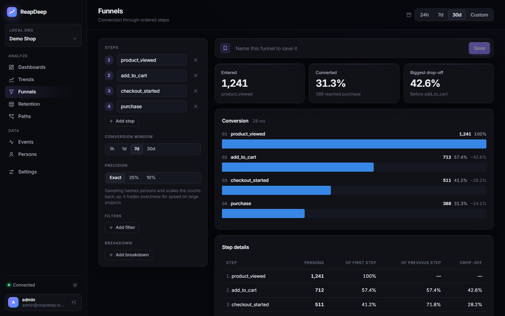 | 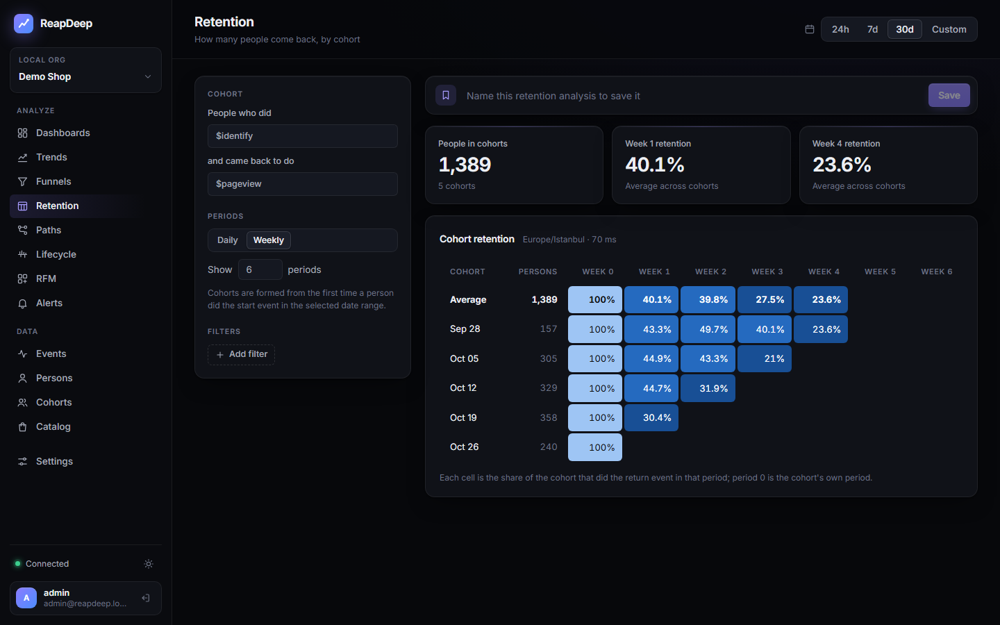 |

| Paths | Person profile |
|---|---|
| 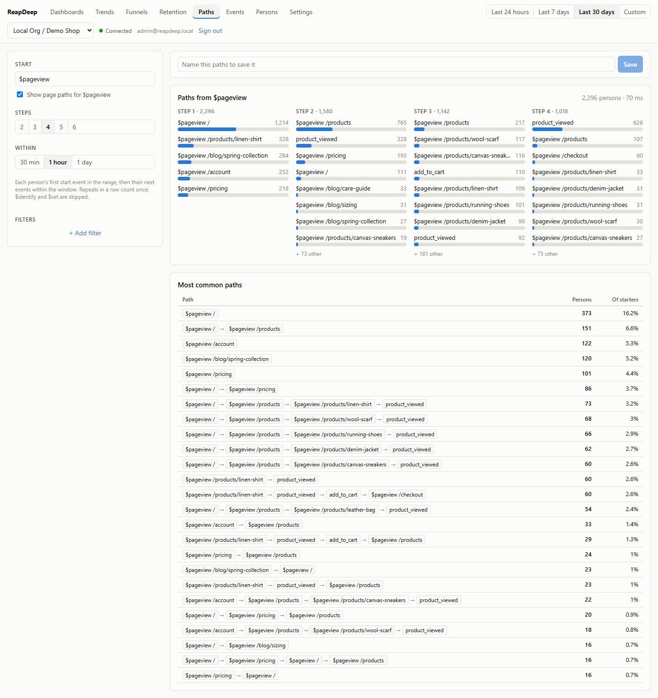 | 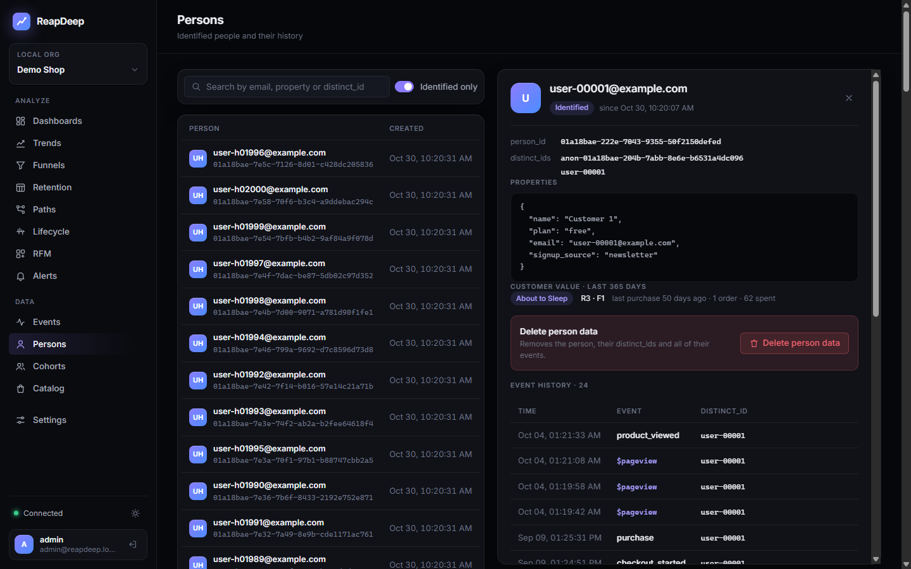 |

The dashboard opens in a dark theme; the light theme is one click away in the sidebar and uses its own validated color steps: [screenshot](docs/images/dashboard-light.png).

### Retention and paths

- **Retention:** cohorts are formed from the first time a person did the start event in the selected range, daily or weekly. Each cell is the share of the cohort that did the return event in that period; periods that have not happened yet are empty, and the average row is weighted by cohort size.
- **Paths:** each person's first start event in the range, followed by their next events within a window (30 min to 1 day), with repeats in a row collapsed and `$pageview` split by page. The result has the top events per step and the most common full paths.

### Trend metrics and formulas

A trend series counts events, counts unique persons, or aggregates a numeric event property (sum, average, median, 90th percentile, minimum, maximum), for example the daily sum of `amount` on `purchase`. Series are named A, B, C... and a formula combines them with `+ - * /` and parentheses: `A / B` with A = sum of `amount` and B = unique buyers is revenue per buyer. Formulas are evaluated per bucket and on the period totals (so unique-user totals stay correct), per breakdown value, and division by zero gives 0. "Compare to previous period" runs every series over the preceding range of the same length and draws it as a dashed line; the tiles show the change in percent.

### Lifecycle and RFM

| RFM segments | Weekly lifecycle |
|---|---|
| 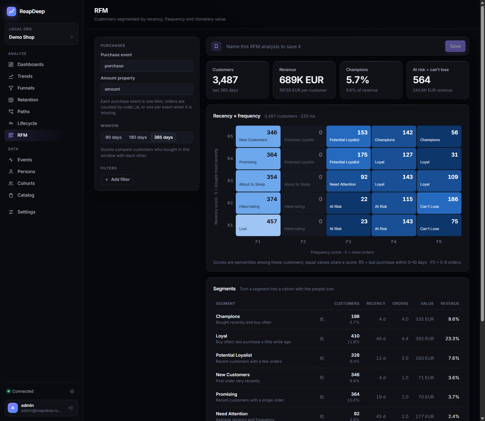 | 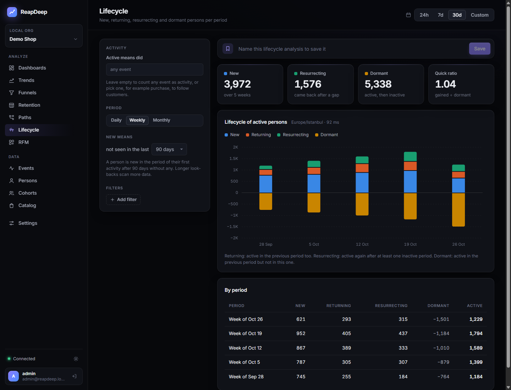 |

- **Lifecycle:** for each day, week or month, active persons are *new* (first activity after N days without any; 90 by default, up to 365), *returning* (also active in the previous period) or *resurrecting* (back after at least one inactive period); *dormant* persons were active in the previous period but not in this one and are drawn below the axis. Activity is any event, or one event such as `purchase`.
- **RFM:** every person who bought in the last 90, 180 or 365 days gets 1-5 scores for recency, frequency (distinct `order_id`s) and monetary value (sum of `amount`). Scores are rank percentiles, so customers with the same number of orders share a score. The recency and frequency scores map to the 11 standard segments, from Champions to Lost, and each segment shows its customers, average recency, orders, value and share of revenue.
- **Segment movement:** pick a segment to see where today's members were N days ago (7, 30 or 90) and where that segment's members of N days ago are now, including "not a customer then" and "no purchase in the window now". The person profile shows each customer's segment, scores, days since the last purchase, orders and spend.
- **Segments as cohorts:** one click saves a segment as a dynamic cohort with an `rfm_segment` condition. The cohort job recalculates it like any other cohort, so a segment can filter or break down every analysis, for example a funnel of "Customers at risk". Both analyses merge anonymous and identified IDs before counting.

### Alerts

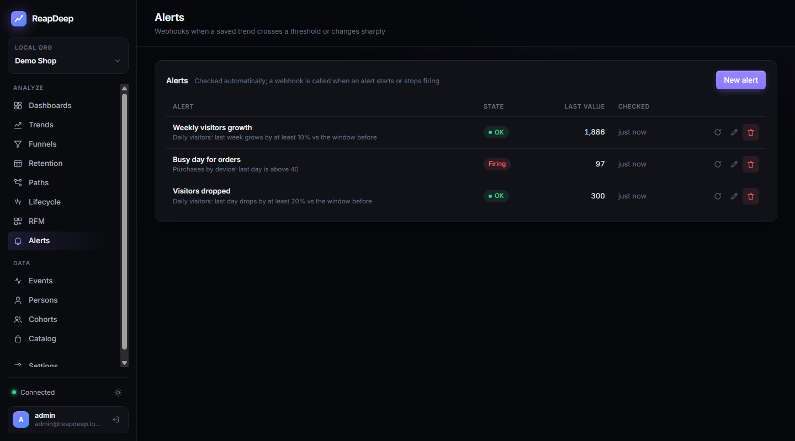

An alert watches a saved trend over the last hour, day or week: *above* or *below* a value, or a *growth* or *drop* of at least N% against the window before. It follows the trend's first series, or its formula when there is one. A background job in the Query API checks hourly-window alerts every 10 minutes, daily ones every hour and weekly ones every 6 hours (instances claim alerts with `FOR UPDATE SKIP LOCKED`), and "Check now" runs one on demand.

A webhook is called only when an alert starts or stops firing, with a JSON body (`state`, `value`, `previous_value`, `message`, the insight) and an `X-ReapDeep-Signature: sha256=<HMAC-SHA256(secret, body)>` header; the secret is shown when the alert is created. Each event and the HTTP status of its delivery are kept in the alert's history. Webhook URLs that resolve to private, loopback or link-local addresses are refused, and the check is repeated on the connection itself so DNS rebinding cannot bypass it; the local compose file sets `Alerts__AllowPrivateWebhooks=true` so tests can use a receiver on the host. Only owners and admins manage alerts.

### Cohorts

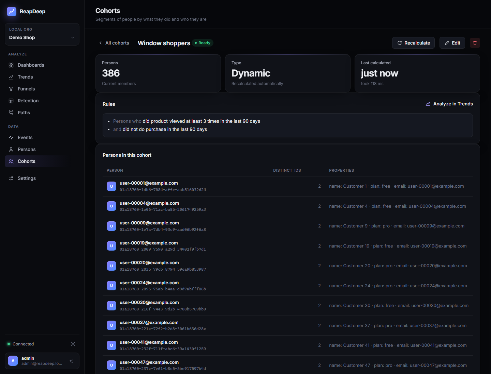

A dynamic cohort is a set of OR'ed groups of AND'ed conditions: *did event X at least / at most / exactly N times in the last D days* (optionally where an event property matches), *did not do event Y in the last D days*, or *person property matches*. Windows are 1-90 days. *RFM segment is one of ...* turns RFM segments into a condition (see above). A static cohort is a list of person ids or distinct_ids, pasted or loaded from a CSV.

- **Materialized membership:** the person worker evaluates the rules in StarRocks and writes the members to `cohort_members` (every distinct_id of each person, so anonymous history counts for the merged person). Cohorts refresh hourly by default; the editor shows a live count computed on the fly.
- **Cheap to use in analyses:** `cohort_members` is keyed by `(project_id, distinct_id)` in the same colocate group as `events`, so a cohort filter (`{"scope":"cohort","property":"<id>","op":"in" | "not_in"}`) is a bucket-local semi or anti join on the events table. Trends and funnels can also break down by up to 5 cohorts.
- **Consistent versions:** each refresh writes a new version and switches to it atomically; the previous version is kept for 60 s so queries already running are not affected.
- **Privacy:** deletion requests also remove the person from every cohort, and refreshes never run at the same time as a deletion batch of the same project.

### Catalog and recommendations

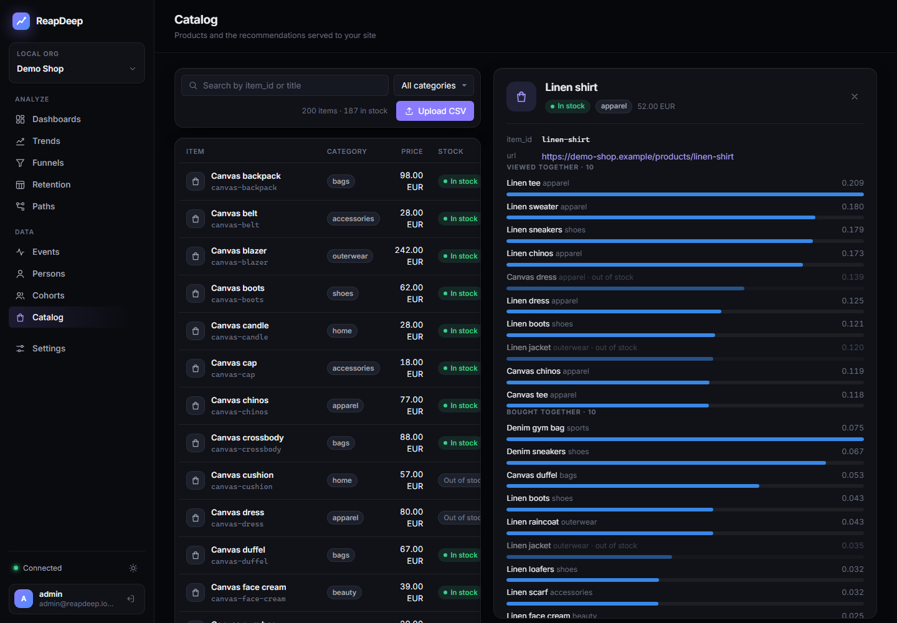

The commerce contract is small: `product_viewed`, `add_to_cart` and `purchase` events with `properties.item_id` (one `purchase` per item, linked by `order_id`; the SDK's `trackPurchase` does that). The catalog lives in PostgreSQL and is written with `PUT /api/v1/items` by an owner or admin, a CSV upload in the dashboard, or a `catalog_write` API key (`ck_...`), which can only reach the catalog endpoints.

| Model | Signal | Window |
|---|---|---|
| `popular` | sum of each person's strongest interaction per item (view 1, cart 3, purchase 5) | 30 days |
| `trending` | last 7 days against the expected share from the 21 days before | 28 days |
| `co_viewed` | cosine similarity of items in the same person's 50 most recent items | 30 days |
| `bought_together` | the same, purchases only | 90 days |

Interactions are counted per `distinct_id` first and then merged per person, so a product viewed before signing in still counts for the signed-in person. The person worker refreshes each project hourly (every minute locally) and keeps 50 candidates per item and 200 for the global lists. The Recommender filters them at request time (in stock, category, not the item itself) and fills short item-based lists with popular items of the same category, marking each item's `source`.

```bash
curl "http://localhost:8002/recommend?api_key=pk_demo_shop&model=co_viewed&item_id=linen-shirt&limit=5"
```

Quality is measured on demand (`POST /api/v1/recommendations/evaluate`, the Catalog tab's "Measure now"): the models are trained on the 30 days before the last week, and for each person the second item they touched last week counts as a hit if it was in the top 10 for their first. On the demo data co_viewed reaches a 27.1% hit rate against 25.4% for the popular baseline; the demo browsing is strongly popularity-driven, so the gap is small.

The recommendation tables hold aggregates over many people, not personal data. A deleted person's interactions drop out at the next refresh.

Measured on the 30M-event seed with a 2,000-item catalog (`load-test.ps1`):

| | Result |
|---|---|
| Recommender, 16 concurrent clients inside the compose network | **p99 3.6 ms**, p50 0.5 ms, 22K requests/s, 0 errors (target p99 < 15 ms) |
| Model calculation: co_viewed / bought_together / popular / trending | 2.8 s / 0.9 s / 0.5 s / 0.6 s |
| Hit-rate evaluation query | 2.0 s |
| Person x item aggregation from the `item_id` column vs. `properties.item_id` | 216 ms vs. 231 ms |

The column is only 7% faster than reading the JSON property, because StarRocks' flat JSON already stores frequent keys as subcolumns; it was kept for simpler SQL and zone maps.

### Saved insights and dashboards

Any trend or funnel can be saved by name from its tab (`/api/v1/insights`). A dashboard (`/api/v1/dashboards`) is an ordered list of saved insights rendered as tiles; the date range picker applies to every tile, and a tile's title opens the insight for editing. Insights store the editor state, not the date range, so the same insight works for "last 24 hours" and "last 30 days". Project members can create and edit them; read API keys can only list them.

### Authentication

- **API keys** (`Authorization: Bearer <key>`) are scoped to one project and are read-only; they cannot create deletion requests. Use them for scripts and integrations.
- **Dashboard sessions:** `POST /api/v1/auth/login` sets an HttpOnly, `SameSite=Strict` cookie valid for 14 days. Requests then name the project in the `X-Project-Id` header, and the API checks the user's organization membership. `GET /api/v1/auth/me` returns the user and their projects; `POST /api/v1/auth/logout` revokes the session.
- Passwords are hashed with PBKDF2-SHA256 (600K iterations), and sign-in is rate limited to 10 attempts per minute per client IP.
- On first start, the Query API creates the `ADMIN_EMAIL` user as owner of every organization when the `users` table is empty.
- **Settings** (dashboard tab and `/api/v1/members`, `/api/v1/api-keys`, `/api/v1/auth/password`): owners and admins add members with a temporary password, change roles and remove members; anyone can change their own password, which signs out their other sessions. Admins cannot create or change owners, and the last owner cannot be demoted or leave. API keys are shown once at creation and stored only as a SHA-256 hash; revoking one takes effect immediately.

### Add the SDK to a page

```html
<script src="reapdeep.min.js"></script>
<script>
  const rd = reapdeep.init('pk_dev_local', { apiHost: 'http://localhost:8000' })
  rd.capture('signed_up', { plan: 'pro' })
  rd.identify('user_123', { email: 'a@example.com' })
</script>
```

Page views (including SPA navigation), sessions, UTM parameters, batching, retries and `sendBeacon` on page unload are handled automatically. See [`sdk/js/README.md`](sdk/js/README.md).

## Performance

Measured with `deploy/local/load-test.ps1` on **a single machine** (16 CPU, 15 GB shared by Docker): the load generator, ingestion, Kafka, a single-node StarRocks and PostgreSQL all run on the same host. The numbers show where the bottlenecks are, not production capacity.

### Ingestion

| Scenario | Achieved | p50 | p95 | p99 | Lost events | Freshness | Ingestion API |
|---|---|---|---|---|---|---|---|
| 10K/s, batch 10, 30 s | 9,999/s | 4.0 ms | 6.5 ms | **7.0 ms** | 0 / 300K | - | 51% CPU, 30 MB |
| 10K/s sustained, batch 50, 60 s | 10,000/s | 6.1 ms | 7.2 ms | **7.4 ms** | 0 / 600K | **3.9 s** | 28% CPU, 31 MB |
| 50K/s peak, batch 100, 20 s | 49,975/s | 5.6 ms | 7.8 ms | **9.2 ms** | 0 / 1M | **10.6 s** | 113% CPU, 49 MB |

Targets: p99 < 50 ms, freshness < 30 s, no loss after `202`. All met with zero Routine Load error rows.

### Queries over 100M events

The seed is 100M events over 30 days, 150K identified persons and 300K distinct IDs. It takes 2.59 GB on disk (ZSTD, 27.3 bytes per event). Each query ran once cold and then 20 times warm.

| Query | p95 | Target |
|---|---|---|
| Trend, total count, daily | **110 ms** | < 1 s, met |
| Trend, unique users (person join) | **1,135 ms** | < 1 s, borderline |
| Trend, unique users + breakdown + filter | **1,115 ms** | < 1 s, borderline |
| Trend with person property filter | **779 ms** | < 1 s, met |
| Trend with exact deduplication | 1,404 ms | optional |
| Funnel, 3 steps, exact | 4,128 ms | < 3 s, **not met** on one node |
| Funnel, 3 steps, 10% sampling | **790 ms** | met (error ~0.3%) |
| Funnel + breakdown, 25% sampling | **1,243 ms** | met (error ~0.5%) |
| Events of one person (bucket pruning) | **28 ms** | - |

The optimizations that got us here: a fixed-offset time bucketing path when the range has no DST change, separate parallel queries instead of `GROUPING SETS`, aggregating to `(distinct_id, bucket)` before the person join, 64-bit hashes for deduplication and funnel keys, and optional deterministic person sampling for funnels. Exact results stay the default. The unique-user and exact-funnel numbers still need to be measured on a multi-node StarRocks cluster.

### Cohorts over 30M events

Measured on a 30M-event seed (the 100M run was stopped by host memory pressure on this machine), so compare each row with its own baseline, not with the 100M table above. The large cohort has 434K persons (about 580K distinct IDs).

| Query | Without cohort | With cohort | Target |
|---|---|---|---|
| First calculation of a cohort ("20+ pageviews in 30 days", 434K persons) | - | **434 ms** | - |
| Trend, total count | 60 ms | **215 ms** | < 1 s, met |
| Trend, unique users | 563 ms | **775 ms** (+38%) | < 1 s, met |
| Trend, unique users, breakdown by 2 cohorts | - | 1,086 ms | < 1 s, borderline |
| Funnel, 3 steps, exact (small cohort narrows the input) | 1,314 ms | **233 ms** | < 3 s, met |
| Funnel, breakdown by 2 cohorts | 1,371 ms | **1,072 ms** | < 3 s, met |
| Funnel, 10% sampling | 237 ms | **522 ms** | < 3 s, met |

The cohort filter is a colocated semi join. For unique users it is applied after the `(distinct_id, bucket)` pre-aggregation, which halved its cost (1,200 ms before). On raw-event queries (totals, funnels) a large cohort still costs a hash probe per event: well inside the targets, but more than the 20% overhead we aimed for.

### RFM and lifecycle over 30M events

Same 30M-event seed (1.5M purchase events, 525K customers in the 365-day window). The full benchmark run was stopped by host memory pressure before these scenarios, so they were measured afterwards one by one on the same data: 1 cold and 5 warm runs, highest warm time shown.

| Query | Slowest warm run | Target |
|---|---|---|
| RFM, 365-day window, all 525K customers | **609 ms** | < 1.5 s, met |
| RFM with a person property filter | 1,107 ms (others ~600 ms) | < 1.5 s, met |
| Lifecycle, weekly, any event, 90-day look-back | **800 ms** | < 2 s, met |
| Lifecycle, daily, `purchase`, 365-day look-back | **461 ms** | < 2 s, met |
| Lifecycle, weekly, any event, with a cohort filter | **673 ms** | < 2 s, met |
| First calculation of an `rfm_segment` cohort (Champions + Loyal, 103K persons) | **697 ms** | < 2 s, met |

The 1.1 s runs of the filtered RFM query overlapped with the person worker's 30 s local cohort refresh, which the benchmark normally pauses.

## Tests

```powershell
dotnet test tests/ReapDeep.UnitTests   # SQL builder tenancy and parameters, cohort, RFM, lifecycle and recommendation SQL, recommender selection, time ranges, passwords, user agents

cd deploy/local
.\identity-test.ps1     # identity resolution, 10 end-to-end scenarios
.\auth-test.ps1         # sign-in, sessions, project access, CORS, X-Forwarded-For, StarRocks grants
.\deletion-test.ps1     # deletion requests and the batch job, end to end
.\settings-test.ps1     # members, roles, password change, API keys
.\insights-test.ps1     # saved insights and dashboards, API and browser
.\cohort-test.ps1       # cohorts: rules, identity merge, static lists, filters and breakdowns, recalculation, deletion
.\rfm-lifecycle-test.ps1  # RFM scores and segments with known answers, rfm_segment cohorts, lifecycle states and look-back
.\alerts-test.ps1       # alerts: validation, firing and resolving, signed webhooks to a local receiver, change and formula conditions, errors
.\recommender-test.ps1  # catalog, key scopes, models from real events, the public Recommender, stock changes
.\query-test.ps1        # Query API: trends, funnels, retention, paths, events, persons, EXPLAIN, latency
.\dashboard-test.ps1    # headless Chrome against the dashboard (Chrome DevTools Protocol)
.\load-test.ps1         # ingestion load, 100M seed, cohort calculation, query benchmark (incl. RFM and lifecycle), cleanup

cd ../../sdk/js
npm test                # SDK unit tests (vitest + jsdom)
.\demo\e2e.ps1          # real browser -> ingestion -> Kafka -> StarRocks
```

Useful commands:

```bash
docker compose exec starrocks mysql -h127.0.0.1 -P9030 -uroot
docker compose exec starrocks mysql -h127.0.0.1 -P9030 -uroot -e "SHOW ROUTINE LOAD FROM analytics\G"
docker compose --profile app down -v    # reset everything, including data
```

Init SQL runs only on empty volumes. After a schema change, run `docker compose down -v` and start again. To run a .NET service outside Docker, pass connection strings through the environment, for example `ConnectionStrings__Postgres="Host=localhost;Database=reapdeep;Username=reapdeep;Password=<from .env>"`.

## Repository layout

```
src/ReapDeep.Ingestion      Ingestion API
src/ReapDeep.PersonWorker   identity resolution, cohort and recommendation calculation, deletion jobs
src/ReapDeep.QueryApi       Query API: feature folders (Analytics, Catalog, Cohorts, Persons, Insights, Organization, ...)
src/ReapDeep.Recommender    public recommendation endpoint, served from memory
src/ReapDeep.Analytics      shared library: every StarRocks analytics query is built here (SqlBuilder, CohortSql, RfmSql, LifecycleSql, RecommendationSql)
sdk/js                      browser SDK
dashboard                   React dashboard, served by nginx
tests/ReapDeep.LoadTest     load generator, 100M seeder, demo data and query benchmark
tests/ReapDeep.UnitTests    unit tests for the pure logic
docs/architecture.md        design decisions, alternatives and measurements
deploy/local                Docker Compose stack, schemas and test scripts
```

## Status and limitations

ReapDeep is an early v1. It runs end to end locally but has not been operated in production yet.

- Alerts notify through webhooks only; there is no e-mail or Slack integration yet, and a failed delivery is recorded but not retried.
- Members are added with a temporary password; there are no invitation emails or password reset by email.
- A person's `created_at` is the time the person worker processed their first `$identify` or `$set`, not the event's own timestamp; it only differs for backfilled data such as the demo seed.
- Retention and paths read raw events and join persons on every query; they are fast on the demo and test data but were not part of the 100M-event benchmark.
- RFM scores are relative to the customers in the report: a filter re-ranks only the matching customers. Amounts are summed without currency conversion (the report warns when it sees several currencies), and there is no refund event yet.
- Cohort membership is the current membership: a 90-day trend filtered by a cohort uses who is in the cohort now, not who was in it on each day. Behavioral windows are limited to 90 days.
- Not in v1: session replay, mobile SDKs, autocapture, feature flags.
- Behind a load balancer, set `ForwardedHeaders__TrustedNetworks` (CIDR list) on the ingestion and Query APIs; `X-Forwarded-For` is ignored otherwise. The Query API sends no CORS headers unless `QueryApi__CorsOrigins` is set.
- The deletion job runs every 30 s in the local compose file so tests finish quickly; the default is once a day (`Deletion__IntervalSeconds`). Raw events also stay in Kafka for its 7-day retention.

## License

Licensed under the [Apache License, Version 2.0](LICENSE). See [NOTICE](NOTICE) for attribution.
