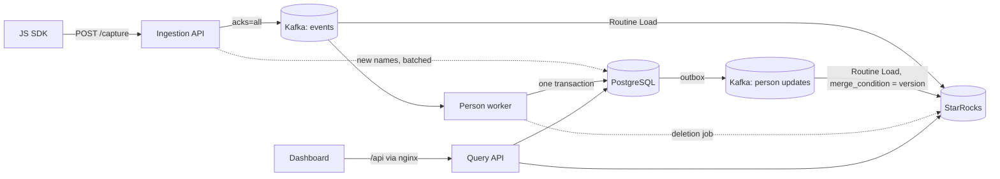

# ReapDeep architecture

This document explains how ReapDeep is built and, more importantly, why. Each section states the
decision, the alternatives that were considered, and the measurement or failure mode that settled it.
The [README](../README.md) covers setup and usage.

## 1. Goals and constraints

| Area | Target | Result (single machine, see section 9) |
|---|---|---|
| Ingestion throughput | 10K events/s sustained, 50K/s peak | 10K and 49,975 events/s |
| Ingestion latency | p99 < 50 ms | 7.0-9.6 ms |
| Durability | an event acknowledged with `202` is never lost | 0 lost of 1.9M |
| Freshness | queryable < 30 s after capture | 3.7-10.6 s |
| Trend query | p95 < 1 s (30 days, project with 100M events/month) | 110 ms totals, ~1.1 s unique users |
| Funnel query | p95 < 3 s (same data) | 4.1 s exact, 0.8-1.2 s sampled |

Other constraints: multi-tenant from day one, only MIT or Apache 2.0 code dependencies (no AGPL or BSL,
which rules out MinIO, Redpanda and k6; the dashboard font, Inter, is SIL OFL 1.1), data stored in a single region, events kept for one year.

## 2. Components

| Component | Responsibility | Why it is separate |
|---|---|---|
| Ingestion API (.NET, Native AOT) | validate, enrich, write to Kafka | the only latency-critical service; stays stateless |
| Kafka | durable buffer between capture and storage | decouples ingestion from StarRocks load and maintenance |
| StarRocks | event, person and mapping tables for analytics | columnar scans plus real joins and upserts |
| PostgreSQL | accounts, projects, keys, persons (source of truth), saved insights | transactional data and row-level locking |
| Person worker (.NET, Native AOT) | identity resolution, outbox publishing, deletion job | keeps identity logic off the ingestion hot path |
| Query API (.NET, Native AOT) | the only producer of analytical SQL; auth and tenancy | one place to enforce `project_id` filters |
| Dashboard (React, nginx) | UI; same origin as the API | no CORS needed, cookie sessions work |

All three .NET services are Minimal API or Worker projects, and compile to Native AOT (about 30-60 MB
of memory each). JSON uses System.Text.Json source generation throughout.

### Code structure

Each service is organized by feature, not by technical layer, and keeps three kinds of classes apart:

| Kind | Examples | Rule |
|---|---|---|
| Endpoints | `MemberEndpoints`, `AnalyticsEndpoints` | map routes, declare access (`.RequireUser()`, `.RequireManager()`), translate results to HTTP; no SQL |
| Services and pure logic | `TrendService`, `MembershipRules`, `EventTimestamps`, `IdentityEvent` | validation and business rules; unit tested without a database |
| Data access | `MemberRepository`, `PersonTransaction`, `StarRocksClient` | one class per store and aggregate; return typed records |

There is deliberately no mediator, no repository interfaces and no generic layers: with one
implementation per abstraction they would only add indirection. Cross-cutting concerns live in one
place each: tenancy in `ProjectAccessMiddleware`, errors in `ApiExceptionHandler` (validation -> 400,
StarRocks resource limits -> 503), and composition in each service's `HostingExtensions`. Tenancy is a
middleware rather than an endpoint filter on purpose: Minimal API binds handler parameters before
filters run, so the project must be resolved earlier for `ProjectContext` to bind as a parameter. Routes
opt in through group metadata (`RequireProjectAccess()`), and per-route role checks are declared next to
the route (`RequireUser()`, `RequireManager()`).

The dashboard follows the same idea: `app/` (shell, routing, theme), `api/` (typed client and
contracts), `components/` (UI primitives, query editors, and the SVG charts), `features/<name>/` (one
folder per screen), `lib/` (hooks and formatting) and `styles/` (design tokens first, then base,
layout, components and charts). There is no UI or chart library; the only runtime dependency besides
React is the self-hosted Inter font, so no request leaves the deployment for fonts or assets.

**Data access choice.** PostgreSQL access uses Dapper with **Dapper.AOT**, which replaces Dapper's
reflection with build-time interceptors so it works under Native AOT. Its analyzer rejects call shapes it
cannot intercept (for example `CommandDefinition`), but it skips row types that are `private` without
any diagnostic, so a unit test enforces that every `*Record` row type is non-private. StarRocks queries
do not use Dapper: their SQL and parameter lists are generated at run time by `SqlBuilder`, so a small
`StarRocksClient` with typed row mappers is simpler and keeps cancellation support for long queries.

## 3. Ingestion

**Request path.** `POST /capture` accepts a batch of up to 1,000 events. Content-Type is ignored so
`navigator.sendBeacon` works. Each event gets:

- a server-assigned UUIDv7 `event_id` when the client did not send one;
- a corrected timestamp: the client clock skew is measured from `sent_at`, future timestamps (more than
  one hour) fall back to server time, and events older than 364 days are rejected;
- user agent parsing into browser, OS and device type;
- promotion of common properties (`$current_url`, `$pathname`, `utm_*`, screen size, ...) to their own
  columns, removing them from the JSON blob.

**The 202 guarantee.** The response waits until Kafka has acknowledged every event in the batch.
The producer uses `acks=all`, idempotence, `linger.ms=5` and LZ4. Micro-batching across concurrent
requests is what keeps p99 low despite `acks=all`. If Kafka does not acknowledge within 10 s, the
client gets `503` and the SDK retries with the same `event_id`, so a retry can create a duplicate but
never a loss. Duplicates are handled at query time (section 6).

**Native AOT.** Confluent.Kafka sets up its native delegates through reflection, which the trimmer
removes. The project roots the assembly (`TrimmerRootAssembly`); without it the service builds but
fails at the first produce call.

**Definitions without a hot-path cost.** The event and property dictionary that powers autocomplete
is maintained by the ingestion API itself. It keeps an in-memory set of `(project, scope, name)` it has
seen, and only names that are new (or not refreshed for an hour) are queued. A background task writes
the queue to PostgreSQL every 10 s with one `unnest` upsert, and infers a type for each property
(string, number, boolean, datetime). A request never waits on PostgreSQL; the cost on the request path
is one dictionary lookup per property. Names are recorded only after Kafka acknowledges the batch, and
each project is capped at 10K names per scope so clients that put IDs into property names cannot
exhaust memory. The load test showed no change in p99.

**Client IP.** `X-Forwarded-For` is honored only from networks listed in
`ForwardedHeaders:TrustedNetworks`. ASP.NET Core treats an empty trusted list as "trust everyone",
so the middleware is not registered at all when the list is empty.

## 4. Storage

### Why StarRocks

ClickHouse was the obvious alternative. The deciding requirement was persons: identity merges change
which person an anonymous distinct ID belongs to, and person properties change over time. StarRocks
offers Primary Key tables with real upserts (and a `merge_condition` for ordering) plus a cost-based
optimizer with colocated joins. In ClickHouse the same model needs ReplacingMergeTree with `FINAL` or
argMax rewrites and dictionary tricks for the join. StarRocks also ingests directly from Kafka with
Routine Load, so no separate consumer service is needed.

### Tables

| Table | Model | Sort key | Distribution |
|---|---|---|---|
| `events` | Duplicate Key (append only) | `project_id, event, timestamp` | `HASH(project_id, distinct_id)`, colocate group `events_pdi` |
| `person_distinct_ids` | Primary Key | `project_id, distinct_id` | same hash, same colocate group |
| `persons` | Primary Key | `project_id, person_id` | `HASH(project_id, person_id)` |

- **Multi-tenancy:** shared tables, `project_id` first in every key. No table per customer.
- **Partitioning:** `events` is partitioned by day with `partition_live_number = 365`, so the one-year
  retention is a partition drop, not a delete.
- **Distribution key:** hashing by `project_id` alone was the first design. It puts a large project's
  day into a single bucket: data skew and a single scan thread, which would make the trend target
  impossible. Hashing by `(project_id, distinct_id)` spreads a project over every bucket, and because
  `person_distinct_ids` uses the same key and bucket count in the same colocate group, the person join
  runs locally on each node without a shuffle. `persons` is joined by `person_id`, so colocating it
  would not help.
- **Properties:** frequent properties are real columns; the rest stay in a `properties` JSON column with
  StarRocks flat JSON enabled. Storage measured 27.3 bytes per event with ZSTD.
- **Bucket count:** 8 locally. For production, 32 was chosen from the measured row size: 10K events/s
  is about 23 GB per daily partition, which is ~0.7 GB per tablet with 32 buckets (StarRocks recommends
  1-10 GB) and fills the scan parallelism of a 3 x 16-core cluster. The bucket count of a colocate group
  cannot change later, so the choice leaves room to grow.

## 5. Identity resolution

The SDK sends `$identify` with the new user ID as `distinct_id` and the previous anonymous ID in
`$anon_distinct_id`, and `$set` for property updates. The person worker consumes the events topic and
only processes those two events.

**PostgreSQL is the source of truth** for persons and mappings. Each event is handled in one
transaction with advisory locks on the involved distinct IDs. The rules:

| `$identify(user, anon)` | Result |
|---|---|
| neither known | create an identified person, link both IDs |
| user known, anon new | link anon to the user's person |
| user new, anon's person anonymous | the user takes over that person |
| user new, anon's person already identified | create a new person for the user; do not move anon |
| both on the same person | apply `$set` only |
| different persons, anon's is anonymous | merge: move all of anon's IDs, properties `P_anon || P_user || $set` |
| different persons, both identified | reject the merge |

Two identified persons are never merged; that is how shared devices stay correct.

**Transactional outbox.** The naive "write PostgreSQL, then publish to Kafka" loses updates if the
process dies between the two steps: on replay the state has already changed, so no update is produced
again. Instead, changed rows are written to `person_outbox` in the same transaction, and a separate
loop publishes and deletes them. StarRocks applies them with `merge_condition = version`, so an older
message can never overwrite a newer row even if delivery order varies.

**No person ID on events.** Events are never rewritten after a merge. Queries resolve the person at
read time with `COALESCE(pdi.person_id, e.distinct_id)` over a `LEFT JOIN`. An early proposal created a
person for every distinct ID and used an `INNER JOIN`; that would have made the worker process every
event, created rows for every bot and anonymous visitor, and made events disappear from queries whenever
the worker lagged. The `LEFT JOIN` gives the same answers without those costs, and it is still colocated.

**Re-created mappings.** New mappings start at a time-based version (microseconds since the epoch),
not 1. Without this, a deleted and later re-created distinct ID would be ignored by StarRocks, because
its deletion tombstone has a higher version than the new row.

## 6. Query layer

**One SQL builder.** Every StarRocks analytics statement is produced in the shared `ReapDeep.Analytics`
library by `SqlBuilder` (and `CohortSql`, which uses its parameters and conditions). The builder's
constructor takes the project ID and a UTC time range and adds both filters; there is no code path that
builds a query without them, and every cohort statement filters by project as well. Values are always parameters, JSON paths are parameters too, and property names are
validated against a strict pattern before they reach SQL.

**Time zones without losing partition pruning.** Projects have a time zone, but `WHERE` clauses use UTC
boundaries computed in C#. A `convert_tz` in the filter would disable partition pruning. The time zone
is only applied when grouping into buckets, and when the range has no DST change the builder uses a
fixed `seconds_add` offset instead of `convert_tz` (about 400 ms faster on 50M rows).

**Optimizations found by the benchmark** (results identical before and after):

| Change | Why | Effect |
|---|---|---|
| Unique users: aggregate to `(distinct_id, bucket)` first, then join persons | the join ran on 50M rows; after the pre-aggregation it runs on ~6M | 2.4 s -> 1.1 s |
| Buckets and period total as two parallel queries instead of `GROUPING SETS` | the grouping-sets plan was slower than two scans | trend 626 -> 110 ms |
| Dedup with `COUNT(DISTINCT xx_hash3_64(event_id))` | distinct on strings exceeded the 13 GB memory limit | HTTP 500 -> 1.4 s |
| Funnel person key as a 64-bit hash, optional deterministic sampling | `window_funnel` itself is the bottleneck (3.7 s even without the join) | exact 4.1 s, 10% sample 0.8 s |

Tried and rejected: higher `pipeline_dop` (slower), a single CTE scan for buckets and totals (not
faster), second-level deduplication before `window_funnel` (no fewer rows).

**Sampling is explicit.** Funnel sampling selects persons by hash, scales the counts, reports the
sampling rate in the response, and the UI labels sampled results. Exact is the default; the choice
between accuracy and speed belongs to the user.

**Retention** forms cohorts from each person's first start event in the range (daily or weekly, in the
project time zone), then counts distinct persons who did the return event in each later period. Periods
that have not happened yet are returned as `null`, so "nobody came back" and "not yet" are different.

**Paths** take each person's first start event, the events that follow within a window, collapse
consecutive repeats with `LAG`, number them with `ROW_NUMBER`, and aggregate both per step and per full
path (`group_concat` with a control-character separator).

**PostgreSQL for person lookups.** Person lists and profiles are read from PostgreSQL, where
`person_id` is indexed; in StarRocks `person_distinct_ids` is distributed by `distinct_id`, so a lookup
by `person_id` would scan every bucket. For a person's event history, the person's distinct IDs come
from PostgreSQL and become an `IN` list on `events.distinct_id`, which prunes buckets (8 of 8 tablets
scanned before, 2 of 8 after).

**Duplicates** from SDK retries are rare. Exact deduplication is 13x slower, so it is an option per
query rather than the default. Unique users and funnels are unaffected by duplicates anyway.

### Cohorts

A cohort is either a rule set (OR'ed groups of AND'ed conditions: performed an event N times in the
last D days, did not perform an event, person property) or a static list of IDs. The design choices:

| Decision | Alternative | Why |
|---|---|---|
| Materialize membership into `cohort_members` | expand the rules into every analysis | a rule scans up to 90 days of events; doing that inside every trend and funnel would double their cost. Materialized, the analysis pays only a join. The live preview in the editor still evaluates the rules on the fly. |
| Key membership by `(project_id, distinct_id)` in the `events_pdi` colocate group | key by person | the cohort filter becomes a bucket-local `LEFT SEMI JOIN` on `events` (verified with EXPLAIN) and does not need the person mapping; the `COALESCE(pdi.person_id, e.distinct_id)` rule is untouched. A person is expanded to all of their distinct IDs when the cohort is calculated. |
| Count per distinct ID first, then `LEFT JOIN` the mapping and sum per person | join first | the same pre-aggregation that made unique users fast; anonymous events still count for the merged person, and "did not do Y" is checked across all of the person's IDs. |
| Calculate in the person worker | in the Query API | the Query API's StarRocks user can only `SELECT`. The rule compiler lives in the shared `ReapDeep.Analytics` library so both services use the same SQL. |
| Versioned writes with a 60 s grace period | overwrite in place | a refresh writes a new version and switches `active_version` in PostgreSQL in one transaction; queries already running finish on the old version, which is dropped once it has been retired for 60 s. |
| Shared/exclusive per-project advisory lock between refreshes and deletion batches | none | without it a refresh that read the static list before a deletion committed could write the deleted IDs back afterwards (found by `deletion-test.ps1`). |

Semantics: analyses use current membership. Refreshes run hourly by default (every 30 s in the local
compose file), at most two at a time, and the jobs' StarRocks user is in its own resource group with a
CPU weight of 2 so calculations do not starve interactive queries. Behavioral windows are capped at
90 days, because each refresh scans that much data; longer windows would need a daily per-person
summary table.

## 7. Authentication and tenancy

- **API keys** are project-scoped and read-only. Only a SHA-256 hash is stored; the key is shown once.
  Lookups are cached for 60 s and revocation clears the cache entry immediately.
- **Dashboard sessions:** email and password (PBKDF2-SHA256, 600K iterations; unknown emails still
  compute a hash so timing does not reveal accounts), a random token in an HttpOnly, `SameSite=Strict`
  cookie, stored hashed in a `sessions` table. Sign-in is rate limited per client IP.
- **Project selection:** session requests name the project in `X-Project-Id`; membership comes from
  `organization_members` (owner, admin, member). Role changes, removals and password changes invalidate
  the cached session immediately.
- **Least privilege in StarRocks:** the Query API connects as a SELECT-only user; the deletion job has
  SELECT and DELETE. `root` is used only by init scripts and tests.
- **CORS** on the Query API is off unless configured; the dashboard is served from the same origin.

## 8. Deletion requests

Deletes are expensive in StarRocks: each `DELETE` on a Duplicate Key table adds delete predicates that
every later scan and compaction must evaluate. Requests are therefore collected and processed by a
periodic job (daily by default), with one `DELETE ... WHERE project_id = ? AND distinct_id IN (...)`
per project and chunk of 500 IDs.

For each batch the job:

1. locks the affected distinct IDs with the same advisory locks the identity worker uses;
2. deletes the events from StarRocks first (idempotent, safe to repeat);
3. in one PostgreSQL transaction removes the mappings and persons, writes tombstones (`is_deleted`,
   `version + 1`, empty properties) to the outbox, and marks the requests processed;
4. later, purges the tombstones from StarRocks. A tombstone cannot be resurrected by an older message,
   because updates for one key always go to the same Kafka partition and are applied in order.

Requests must be at least ten minutes old so events still in flight in Kafka are deleted too. Raw events
remain in Kafka for its seven-day retention, which is within the 30-day deletion target.

## 9. Performance results

Measured with `deploy/local/load-test.ps1` on one machine (16 CPU, 15 GB for Docker) shared by the load
generator, Kafka, single-node StarRocks and PostgreSQL. Treat the numbers as relative.

| Ingestion scenario | Achieved | p99 | Lost | Freshness |
|---|---|---|---|---|
| 10K/s, batch 10 | 9,999/s | 7.0 ms | 0 / 300K | - |
| 10K/s sustained, batch 50 | 10,000/s | 7.4 ms | 0 / 600K | 3.9 s |
| 50K/s peak, batch 100 | 49,975/s | 9.2 ms | 0 / 1M | 10.6 s |

One methodology finding: running the generator from the Windows host gave a p99 of 0.4-1.5 s, entirely
caused by Docker Desktop's port forwarding. Running it inside the compose network gave the numbers
above.

| Query over 100M events, 30 days | p95 |
|---|---|
| Trend, total, daily | 110 ms |
| Trend, unique users | 1,135 ms |
| Trend with person property filter | 779 ms |
| Funnel, 3 steps, exact | 4,128 ms |
| Funnel, 3 steps, 10% sample | 790 ms |
| Events of one person | 28 ms |

Unique users is at the edge of its target and the exact funnel misses it on one node. Both are
CPU-bound in StarRocks and should be re-measured on a multi-node cluster; the next steps would be daily
pre-aggregated tables and HLL sketches for unique counts.

Cohorts were measured on a 30M-event seed (the 100M run hit host memory limits), each against its own
baseline on the same data. The largest cohort (434K persons, ~580K distinct IDs) is calculated in
434 ms. With it as a filter: trend total 60 -> 215 ms, unique users 563 -> 775 ms, funnel with 10%
sampling 237 -> 522 ms; a funnel filtered to a small cohort gets faster (1,314 -> 233 ms). The first
version of the unique-users query joined the cohort on raw events and cost 1,200 ms; joining after the
`(distinct_id, bucket)` pre-aggregation gives identical results at 775 ms. On raw-event queries the
overhead is still above the 20% we aimed for, though far inside the latency targets; a narrower
membership representation (for example a per-cohort bitmap of person hashes) would be the next step if
it matters.

## 10. Testing

The system is verified end to end against the real stack rather than with mocks:

| Script | What it proves |
|---|---|
| `identity-test.ps1` | all identity rules, replays, outbox ordering, the colocated `LEFT JOIN` |
| `query-test.ps1` | every query type against data with known answers, EXPLAIN plans, latency |
| `deletion-test.ps1` | person and distinct ID deletion, returning users, tombstone purge, removal from cohorts |
| `cohort-test.ps1` | cohort rules against known answers (identity merge, negation, OR, static lists), filters and breakdowns, 404/409, recalculation, purge |
| `auth-test.ps1`, `settings-test.ps1` | sessions, roles, API keys, CORS, forwarded headers, StarRocks grants |
| `dashboard-test.ps1`, `insights-test.ps1` | headless Chrome over the DevTools Protocol, every tab and dashboards |
| `load-test.ps1` | throughput, latency, loss and freshness; the 100M-event query benchmark |

Unit tests cover the pure logic: the SQL builder's mandatory filters and parameterization, the cohort rule
compiler and its validation, time range
parsing and bucketing, password hashing and user agent parsing. CI builds everything and runs the SDK and
unit tests on every push.

## 11. Known limits and what production would need

- Multi-node StarRocks and Kafka replication, then a repeat of the benchmark.
- Versioned schema migrations; today the local stack is recreated when the schema changes.
- Observability: metrics for ingestion latency, Kafka lag, Routine Load errors and the deletion job.
- Caches are per Query API instance; with several instances, revocations take up to 30-60 s to apply
  everywhere.
- No invitation or password reset emails.
